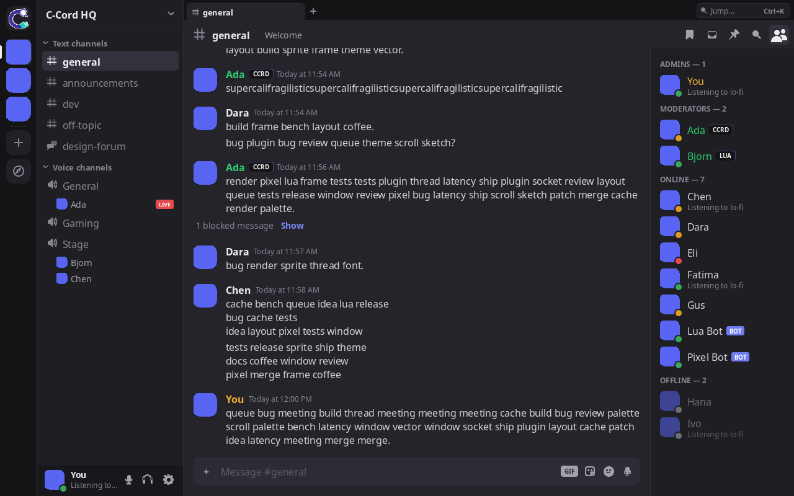
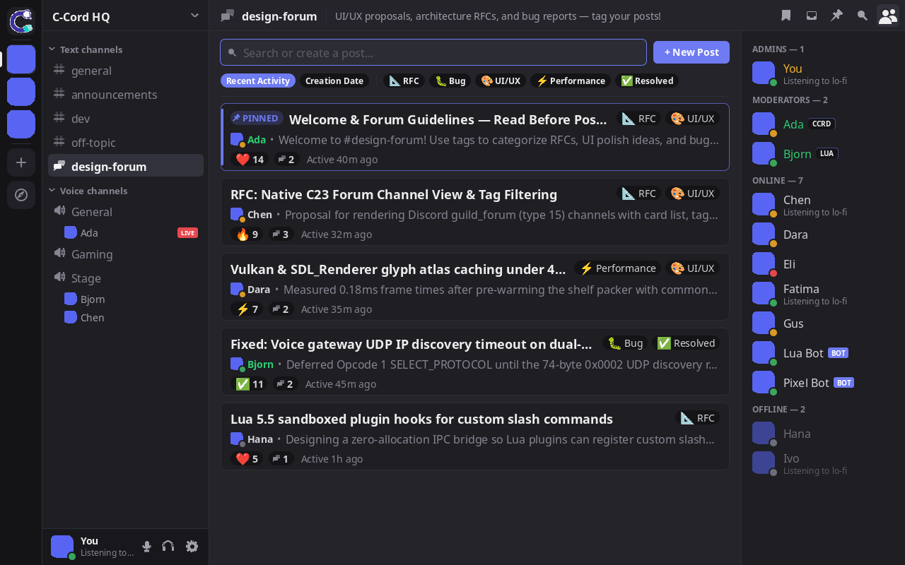
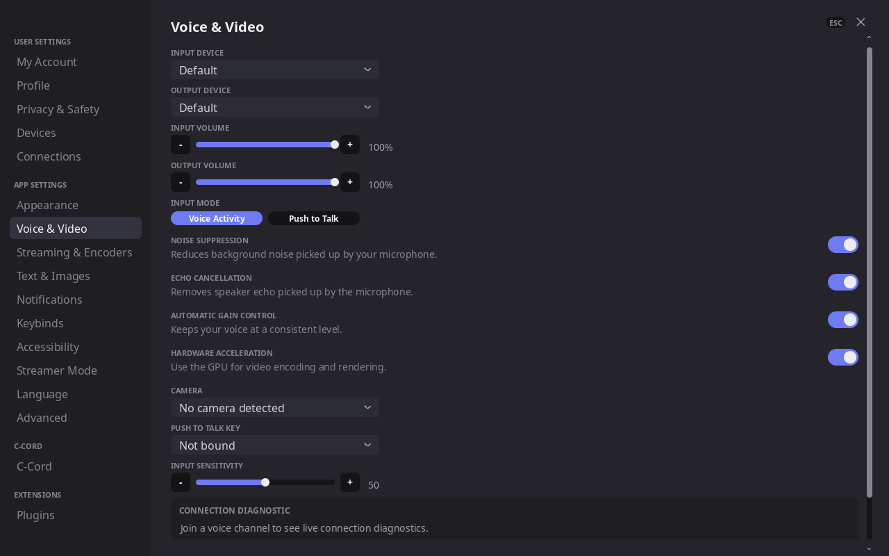
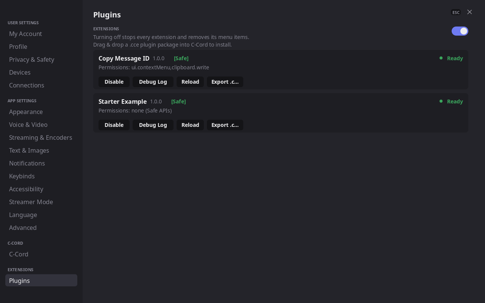

<p align="center">
  
</p>

<h1 align="center">C-Cord</h1>

<p align="center">
  <strong>A fast, native Discord-compatible desktop client written in C23 with sandboxed Lua 5.5 extensions.</strong>
</p>

---

> [!WARNING]
> **Third-Party Client Disclaimer:** C-Cord is an independent project and is **not** affiliated with, endorsed by, or supported by Discord Inc. Using a personal Discord user token with any third-party client violates Discord's Terms of Service and is done entirely at your own risk.

> [!IMPORTANT]
> **Account & Billing Safety:** C-Cord never collects or mimics payment or credential forms. Billing, Nitro, Shop, Server Boost checkout, OAuth account linking, and account credential edits (email, password, 2FA) always open `discord.com` in your web browser.

---

## Showcase

*All screenshots below are captured using C-Cord's built-in offline mock workspace (`--mock`).*

### Desktop Chat Workspace


### Native Forum Channels & Tag Filtering


### Voice, DSP & Hardware Acceleration


### Out-of-Process Lua Extensions


---

## Features

### Messaging & Communities
- **Rich Chat:** Markdown formatting, ANSI code blocks, embeds, multi-file uploads, attachment galleries, spoiler media, lightbox viewer, inline audio/video playback, polls, interactive buttons/selects/modals, reactions, super-reactions, threads, forum channels, pins, and operator search.
- **Navigation & Organization:** Server folders, drag-and-drop server/channel reordering, back/forward history, `Ctrl+K` quick switcher, Unreads/Mentions Inbox, Saved Messages, and Server Discovery.
- **Social & Moderation:** Friends list, DMs & group DMs, Message Requests, full user profiles, Rich Presence (`discord-ipc-0`), Server Settings, Roles (with View Server As Role), AutoMod, Audit Log, Channel Settings, and per-member voice moderation.

### Voice, Video & E2EE
- **Voice Calls & Stage Channels:** Real-time audio device hot-plugging, push-to-talk, optional SpeexDSP noise suppression / echo cancellation / AGC, per-user volume controls, soundboard playback, DM/group calls, and voice messages.
- **DAVE Voice E2EE:** Built-in Discord Audio & Video End-to-End Encryption powered by `libdave` and `mlspp`.
- **Screen Sharing & Camera:** Go Live streaming and watching (H.264 + Opus stream audio), Wayland screen/window capture via `xdg-desktop-portal` + PipeWire with X11 fallback, and webcam capture.

### Desktop Experience & Customization
- **Three Built-In Themes:** **Matte Graphite** (Dark), **Warm Stone** (Light), and **Obsidian** (AMOLED), plus UI zoom (`75%`–`200%`), custom style overrides, and reduced-motion mode.
- **Linux Desktop Integration:** System tray icon with unread/mention badges, `org.freedesktop.Notifications` desktop alerts, `GlobalShortcuts` portal keybinds, IME preedit support, and bundled Noto Sans / Emoji / CJK fonts.
- **Security-First Design:** Strict TLS 1.2/1.3 verification, `0600` file permissions for local tokens/sessions, and out-of-process Lua 5.5.1 plugin isolation with `SO_PEERCRED` socket verification and a **3-Class Permission Model**.

---

## Getting Started

### Build & Install (Linux)

1. **Install build dependencies** (example for Arch Linux):
   ```sh
   sudo pacman -S --needed base-devel cmake ninja python \
     sdl3 sdl3_ttf ffmpeg pipewire opus libsodium curl openssl speexdsp \
     libx11 libxext libxcomposite libxrandr libxfixes glib2 dbus nlohmann-json
   ```
2. **Configure, build, and install:**
   ```sh
   cmake -S . -B build-rel -G Ninja -DCMAKE_BUILD_TYPE=Release -DCCORD_BUILD_TESTS=OFF -DCMAKE_INSTALL_PREFIX=/usr/local
   cmake --build build-rel --parallel
   sudo cmake --install build-rel
   ```

### Running C-Cord

Launch the desktop client from your application menu or terminal:

```sh
ccord
```

- **First launch (no saved token):** Opens the Login Screen.
- **Live Discord session:** `ccord --live` connects using your saved token (`$XDG_CONFIG_HOME/ccord/token`).
- **Offline preview mode:** `ccord --mock` opens the deterministic offline demo workspace shown in the screenshots above.
- **Tray / single-instance controls:** `--start-minimized`, `--show`, `--toggle-mic`, `--toggle-deafen`, `--quit`.

<details>
<summary>Common CLI Options (run <code>ccord --help</code> for the full list)</summary>

| Flag | Description |
|---|---|
| `--version` / `-v` | Print C-Cord version and exit |
| `--live` | Connect to Discord with your saved user token |
| `--mock` | Launch with the offline mock workspace |
| `--login-screen` | Open the login screen over an empty store |
| `--token-file PATH` | Use a custom token file path |
| `--theme PATH` | Load a `.theme` file (overrides `settings.ini`) |
| `--size WxH` | Set initial window size (default `1280x800`) |
| `--plugin-dir DIR` | Load extensions from an extra directory (repeatable) |
| `--no-plugins` | Start without loading extensions |
| `--no-rpc` | Disable the local Discord Rich Presence IPC socket |
| `--headless` | Run with SDL `dummy` video driver (no display required) |
| `--screenshot PATH` | Render a frame to PNG and exit |
| `--log-level LEVEL` | Set log verbosity (`debug`, `info`, `warn`, `error`) |

</details>

---

## Extensions (Lua 5.5)

C-Cord extensions are Lua 5.5 plugins packaged as `.cce` (`.zip`) archives or folders containing a `plugin.json` manifest and `main.lua`. Drag and drop any `.cce` package onto the C-Cord window to install it, or manage installed plugins under **Settings → Plugins**.

Each extension runs in a separate `ccord-plugin-host` process governed by the **3-Class Permission Model**:

- **Class 1 (Safe):** UI context menus, toasts, slash commands, plugin-scoped storage, clipboard write — granted automatically.
- **Class 2 (C-Cord Internal):** Custom UI panels (`ui.panel.*`), store reads, message/voice/presence actions — requires explicit user consent (**Amber warning**).
- **Class 3 (System-Level):** Filesystem, HTTP, and system execution APIs — requires explicit user consent (**Red warning**).

See the [Plugin Developer Guide](docs/plugin-api/README.md), [Plugin API Reference](docs/plugin-api/api-reference.md), and the [AGPL-3.0 Extension Exception](LICENSES/C-Cord-Extension-Exception.txt) (allowing extensions to use any open-source or proprietary license), or inspect [`extensions/starter-example/`](extensions/starter-example/) and [`extensions/copy-message-id/`](extensions/copy-message-id/).

---

## Developer Information

### Architecture & Documentation

- [Architecture Overview](docs/architecture.md) — module layout, CMake link-time layering, and plugin isolation.
- [Security Policy](SECURITY.md) — TLS, DAVE E2EE, `SO_PEERCRED` IPC verification, and vulnerability reporting.
- [Plugin API Docs](docs/plugin-api/README.md) — extension manifest rules and Lua API reference.
- [Third-Party & Asset Licenses](assets/LICENSES.md) — fonts, icons, themes, Lua 5.5.1, `libdave`, and `mlspp`.

### Dependencies & Toolchain

| Component | Version / Pin | Source |
|---|---|---|
| C Compiler | GCC 16.2.1 or Clang 23.1.4 tested (`-std=c23`, no extensions) | System |
| CMake / Ninja | CMake >= 3.25 | System |
| SDL3 & SDL3_ttf | 3.4.20 / 3.2.2 (`cmake/Pins.cmake`) | System (`CCORD_DEPS=system`) or `fetch` |
| Lua | 5.5.1 (SHA-256 verified) | Vendored in [`third_party/lua`](third_party/lua) |
| `libdave` + `mlspp` | Pinned commits (`cmake/Pins.cmake`) | Vendored in [`third_party/libdave`](third_party/libdave) & [`third_party/mlspp`](third_party/mlspp) |
| Media & Net Libraries | libcurl (WebSocket), OpenSSL 3, zlib, opus, libsodium, FFmpeg, libpng/jpeg/webp, PipeWire, optional speexdsp, X11, GIO, DBus | System `pkg-config` |
| Fonts | Noto Sans, Noto Color Emoji subset, Noto Sans CJK subset (SIL OFL 1.1) | Bundled in [`assets/fonts`](assets/fonts) |

### Development Builds, Tests & Fuzzing

Default build with tests and `-Werror` enabled:

```sh
cmake -S . -B build -G Ninja -DCCORD_WERROR=ON -DCCORD_BUILD_TESTS=ON
cmake --build build --parallel
SDL_VIDEODRIVER=dummy SDL_AUDIODRIVER=dummy ctest --test-dir build -j8 --output-on-failure
```

Sanitizer build (ASan + UBSan):

```sh
cmake -S . -B build-asan -G Ninja -DCCORD_WERROR=ON -DCCORD_BUILD_TESTS=ON \
      -DCCORD_SANITIZE=ON -DCMAKE_BUILD_TYPE=Debug
cmake --build build-asan --parallel
SDL_VIDEODRIVER=dummy SDL_AUDIODRIVER=dummy ctest --test-dir build-asan -j6 --output-on-failure
```

Fuzz harnesses (Clang + libFuzzer):

```sh
cmake -S . -B build-fuzz -G Ninja -DCCORD_FUZZ=ON -DCCORD_BUILD_TESTS=ON
cmake --build build-fuzz --parallel
SDL_VIDEODRIVER=dummy ctest --test-dir build-fuzz -R '^fuzz_' --output-on-failure
```

<details>
<summary>CMake Build Options</summary>

| Option | Default | Meaning |
|---|---|---|
| `CCORD_VERSION` | `"0.1.0"` | Compile-time version string (`v`-prefixed tags normalized automatically) |
| `CCORD_WERROR` | `ON` | Treat compiler warnings as errors |
| `CCORD_BUILD_TESTS` | `ON` | Build CTest suites and headless `--verify-slice` harnesses |
| `CCORD_SANITIZE` | `OFF` | Enable ASan and UBSan across all targets |
| `CCORD_FUZZ` | `OFF` | Build libFuzzer harnesses (requires Clang) |
| `CCORD_DEPS` | `system` | `system` or `fetch` for SDL3 / SDL3_ttf |
| `CCORD_STRICT_PINS` | `OFF` | Require exact pinned SDL3 / SDL3_ttf versions |
| `CCORD_LIVE_ACCOUNT` | `ON` | Build live REST / Gateway / voice transport (`OFF` for offline-only) |
| `CCORD_DAVE` | `ON` | Build Discord DAVE voice E2EE (`libdave` + `mlspp`) |

</details>

---

## License

C-Cord is released under the **GNU Affero General Public License v3.0 (AGPL-3.0)** with an explicit [**Extension Exception**](LICENSES/C-Cord-Extension-Exception.txt) under AGPL-3.0 Section 7 permitting independent Lua extensions to be distributed under any open-source or closed-source license — see [`LICENSE`](LICENSE) and [`LICENSES/C-Cord-Extension-Exception.txt`](LICENSES/C-Cord-Extension-Exception.txt). Bundled fonts, `extensions/starter-example/`, and third-party components retain their respective licenses; see [`assets/LICENSES.md`](assets/LICENSES.md).
